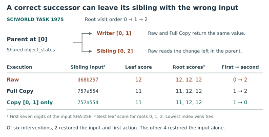

# World Model Planning Reliability

**Can a simulated action return the expected successor and still change the planner’s first choice?** On SciWorld task 1975, a transition returned the same successor as an independent full copy but wrote into its parent’s shared `object_states` dictionary. The next sibling then matched 12 goal fields instead of 11, changing the planner’s first action. The figure traces the write and shows what happened when only that edge ran on a copy. [Task 1975 trace](studies/sciworld-fixed-work-v1/public/report.md)

**How often did the first action change?** On **7/64** prospectively sampled states, the live-parent and full-copy searches chose different actions in at least one of six visit orders under the primary, lowest-index tie rule (exact 95% interval **5.63%–19.48%** for the 231 eligible representatives). Isolating one traced write restored the affected sibling’s input in all 28 differing orders. It restored the first action in **10/28**. The other **18/28** still differed. [Prospective report](studies/sciworld-prospective-v1/report.md)

**What does the comparison establish?** WCTR, a restricted Python runtime for isolating search branches, matched the independent Full Copy reference. It used Full Copy on **every SciWorld search call**, so these runs establish no selective-copy speed advantage. All reference maxima were tied, and breaking ties by highest index gave **3/64** affected states. Candidate commands came from entire offline trajectories and could first appear after the sampled step. The study measures decisions inside one released program with synthetic goals. Online action availability and native task success remain open. [Sampling and decision rules](studies/sciworld-prospective-v1/protocol.md) · [Recorded outcomes](studies/sciworld-prospective-v1/public/analysis.json)

[Zhijing Wu](https://zhijingwu.github.io/) · Sichuan University · Independent research

[Two-page research note](professor-release/WCTR_Research_Note.pdf) · [Editable LaTeX](professor-release/WCTR_Research_Note.tex) · [Reproduce at three levels](studies/sciworld-prospective-v1/README.md) · [Claims and evidence](CLAIMS_AND_LIMITATIONS.md)



## The comparison

Each planner used the same program, candidates, goal and fixed search tree. **Raw** reused its live parent. **Full Copy** ran the original model on a fresh deep copy at every edge. **WCTR** (Witness-Compiled Transactional Rollouts) can pre-copy likely write targets learned from earlier calls, record unexpected supported writes, and detach a successor before restoring its parent. Its selective path has separate regression and cost evidence. [Runtime contract](docs/SUPPORTED_STATE.md) · [Frozen release](https://github.com/ZhijingWu/world-model-planning-reliability/tree/wctr-runtime-repair-2026-11) · [Implementation](src/wctr/isolation.py)

| Question | Selected case bank | Prospective sample |
| --- | ---: | ---: |
| States with a changed first action under the primary rule | 1 / 11 | 7 / 64 |
| Orders with a changed first action | 6 / 66 | 28 / 384 |
| Interventions restoring both the sibling input and reference first action | 2 / 6 | 10 / 28 |
| Raw search claims of exact success that failed independent replay | 18 / 66 | 24 / 384 |
| WCTR search calls using Full Copy | 792 / 792 | 4,608 / 4,608 |

In the selected case bank, both successful interventions recovered the first action, while the second action still differed. In the prospective bank, 15/64 states showed a changed leaf score, and every state with a changed first action had at least one unresolved order. Full Copy and WCTR had zero false goals in both banks. [Original records](studies/sciworld-fixed-work-v1/public/verification.json) · [Prospective records](studies/sciworld-prospective-v1/public/analysis.json)

## Reproduce the evidence

1. **Illustration.** From the repository root in PowerShell, set `$env:PYTHONPATH = (Resolve-Path src).Path`, then run `python examples/branch_isolation.py`. In a POSIX shell, use `PYTHONPATH=src python examples/branch_isolation.py`. This small synthetic example shows how successor agreement and parent preservation differ.
2. **Verify the published measurements.** Run the standard-library commands below. They read the committed public artifacts and require no data download.
3. **Rebuild and run the study.** Retrieve the pinned trajectory files, reconstruct the source-disjoint frame, regenerate the manifest, run the three arms, and audit the resulting private edge snapshots. The walkthrough includes a fresh-checkout reproduction record. [Full instructions](studies/sciworld-prospective-v1/README.md)

```sh
python -B -S studies/sciworld-prospective-v1/verify.py --repo . --case-study
python -B -S studies/sciworld-prospective-v1/verify.py --repo . --bundle studies/sciworld-prospective-v1
python -B -S experiments/verify_evidence.py
```

## Earlier evidence and costs

The historical runtime at `3c902203` recorded **33,692 WCTR parent/output checks** with zero observed failures. Under deadline-limited program search, WebShop completion increased **17.5 percentage points** and Wordle decreased **9.2 points** versus Full Copy. In native interaction, all four protected methods completed **6/12** WebShop goals and **43/100** Wordle seed tasks. Combined measured CPU time was **261.31 s** for Full Copy, **245.96 s** for Top-Field, **248.40 s** for Journal Only and **257.62 s** for WCTR, with one measured lifetime per arm and domain. [Historical evidence](results/README.md) · [Evaluation boundaries](docs/EVALUATION.md) · [Historical technical note](note/Zhijing_Wu_World_Model_Planning_Note_Final.pdf)

A separate synthetic diagnostic on an earlier repair candidate found that a first append on a 64-row state cost **374.56 µs** with WCTR and **178.68 µs** with raw Full Copy. For a calibrated append the medians were **153.05 µs** and **175.84 µs** respectively. These operation-specific costs and the observed SciWorld fallbacks limit any efficiency conclusion. [Diagnostic methods and raw measurements](diagnostics/ast-gate/README.md)

## What to investigate next

Can a shared write overturn a **unique** best action? The isolated planner had a tied best score in every prospective order. A new, disjoint sample with a scoring rule justified and fixed in advance could test that question across reference score margins. Native utility would need an independently observed environment outcome. [Research interpretation](professor-release/INTERPRETATION.md) · [Unresolved cases](studies/sciworld-prospective-v1/report.md) · [Related work](professor-release/RELATED_WORK.md)

This independent research artifact uses the released PatchWorld models and retains their upstream license. Checked inputs, model provenance, publication limits and the original author’s licensing terms are documented below. [Upstream model](third_party/PatchWorld/UPSTREAM.md) · [Provenance](docs/PROVENANCE.json) · [Licensing](docs/LICENSING.md) · [MIT license](LICENSE) · [Release QA](professor-release/QA.md)
