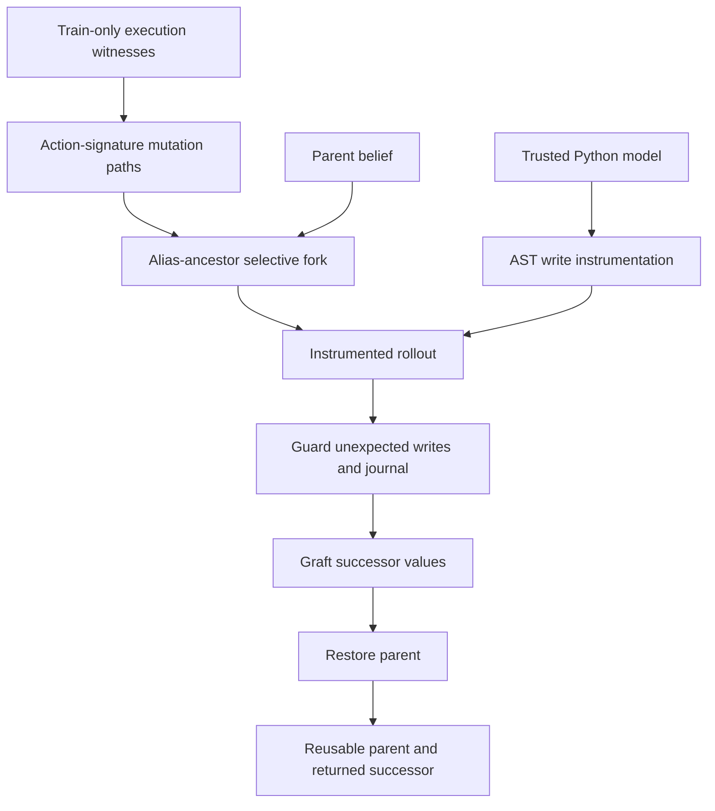

# World Model Planning Reliability

**Correct successor values can still contaminate a planner's search.** This independent research project examines state ownership in executable world models and implements **Witness-Compiled Transactional Rollouts (WCTR)**, a restricted Python runtime mechanism for isolating hypothetical branches.

[Zhijing Wu](https://zhijingwu.github.io/) · Sichuan University · Independent research

[Two-page technical note](note/Zhijing_Wu_World_Model_Planning_Note_Final.pdf) · [Claims and limitations](CLAIMS_AND_LIMITATIONS.md) · [Reproduction](REPRODUCIBILITY_CHECK.md) · [Evidence provenance](docs/PROVENANCE.json)

## Why state ownership matters

A model can shallow-copy a belief dictionary, change a nested object, and return the same values as execution on a deep copy. The original nested object still belongs to the caller. The next hypothetical branch therefore starts from a contaminated parent. Output agreement alone misses this failure at the model/search interface.

The operational target is an unchanged parent plus successor **value equivalence to the same program executed on a full copy**. It does not establish ground-truth predictive accuracy.

## What I implemented and studied

- Diagnosed state mutation in released executable models, including 59 mutations in 3,942 recorded BabyAI predictions.
- Implemented alias-aware selective copying from witnessed mutation paths, private-allocation tracking, guarded writes, output grafting, and parent rollback.
- Compared isolation methods under one controlled planner, then separated program-goal completion from actual interactive task completion.
- Identified the limits of the runtime contract and the absence of an incremental native-success advantage in the tested setting.

WCTR combines established ideas from copying, transactions and execution profiling. This repository makes no claim to invent those ideas or establish theoretical novelty. It is an implemented runtime prototype, not a general world-model learning algorithm.

## Mechanism



The journal handles supported writes absent from the witnessed frontier. Dict/list cycles and shared references are handled by alias closure; tuple-cycle and initialized-defaultdict cases use full-copy fallbacks. See [the supported-state contract](docs/SUPPORTED_STATE.md).

## Selected frozen evidence

| Question | Result | Interpretation |
| --- | --- | --- |
| Does correct output imply an unchanged input? | BabyAI: 59/3,942 input mutations in recorded predictions. In 300-call unprotected samples, WebShop mutated 261 inputs and Wordle 300, while both had zero output mismatches. | Finite artifact observations; output equality and state ownership are separate. |
| Does WCTR meet the checked contract? | 0 parent/output contract failures in 33,692 WCTR live-study transitions (240 WebShop + 33,452 Wordle). | Supported workload checks; the other protected methods also had zero failures. The four-arm total is 134,768, not WCTR alone. |
| Does bounded program-goal completion improve? | WebShop: 47.1% Full Copy → 64.6% WCTR, **+17.5 pp**, paired source-item bootstrap 95% interval **[+10.6, +24.8] pp**. Wordle: 54.2% → 45.0%, **−9.2 pp**, interval **[−14.1, −4.8] pp**. | Mixed controlled results; this is **not native WebShop success**. |
| Does native completion improve? | Full Copy, Top-Field, Journal Only and WCTR each completed **6/12 WebShop goals** and **43/100 Wordle seed tasks**, with identical paired action sequences. | Four-way tie; no incremental native-success benefit. |
| Is WCTR generally cheaper? | Combined measured CPU: Full Copy 261.31 s; Top-Field 245.96 s; Journal 248.40 s; WCTR 257.62 s. | Simpler controls were cheaper overall. One measured lifetime per arm on one host; no general efficiency or superiority claim. |

**Controlled setting:** 80 generated structured-state program-goal tasks per program, three timing repeats, shared breadth-first search, depth ≤6, ≤4,096 transitions, soft 10 ms deadline excluding setup/calibration. Returned plans were checked by independent full-copy execution of the released program. Source-item bootstrap uses 5,000 resamples; timing repeats are averaged within task. WebShop and Wordle intervals use 29 and 30 source-item clusters respectively. All five programs and all six methods remain in the [numerical records](results/README.md).

**Native setting:** released generated models; small 1k-product WebShop catalog, 12 final human goals (smoke excluded); official AgentGym/LMRL seeded 40-word stochastic Wordle, 100 seed tasks. A Wordle seed is not a fixed target word: the released game resamples from a filtered vocabulary. The released model's hardcoded `target_word="frame"` was retained. Each domain/method had a 180 CPU-second lifetime allowance including setup, verification, profiling, serialization and normal exit; package provisioning was unmeasured. All eight workers finished within allowance. See [evaluation boundaries](docs/EVALUATION.md).

## Run the lightweight checks

Python 3.10 or newer; the core, tests, example and evidence verifier use only the standard library. From the repository root:

```sh
python -m pip install --no-deps --no-build-isolation -e .
python -m unittest discover -s tests -v
python examples/branch_isolation.py
python experiments/verify_evidence.py
```

The installation command needs an existing `pip`/`setuptools` build toolchain. An installation-free alternative is to set `PYTHONPATH` to `src` (`$env:PYTHONPATH = (Resolve-Path src)` in PowerShell; `export PYTHONPATH="$PWD/src"` in a POSIX shell) before the same commands. The evidence verifier analyzes completed records; it does not run new experiments or inference. The example is an illustrative fixture, not a measurement.

[Optional original experiment harnesses](experiments/README.md) require independently obtained assets. Full native reruns were not performed for this publication and are not self-contained in this small repository. Raw environment observations, product data, datasets, checkpoints, private logs and original Git history are excluded.

## A proposed next question

**Which simulator errors can change the action a planner chooses?**

Proposed future work, not executed: fix one initial state, three candidate actions, a leaf-value rule, and canonical tie-breaking. Reset for each of six root-action permutations; keep child order fixed and evaluate depth two with exactly 12 expansions and no early stopping. Compare unprotected execution, Full Copy and WCTR. Start deterministic; then pair five predeclared controllable random tapes keyed to action history. Measure ranking inversions, chosen-action flips against Full Copy, and parent fingerprints. Within-tape order effects require a stable reference before being attributed to contamination; Full Copy's across-tape variation supplies the legitimate-stochasticity control. Record CPU/setup separately while holding expansion budget and action set fixed.

This connects execution integrity to decision-relevant model errors in world-model-based reasoning and planning. No UC San Diego affiliation, MixLab endorsement or validation by Prof. Zhiting Hu is implied.

## Limitations

The contract is limited to supported instrumented container operations and trusted single-call execution. Arbitrary Python, globals, custom attributes, C-extension writes, external resources and uncontrolled randomness are outside it. Shared untouched objects can remain shared after a call; arbitrary later mutation is not isolated. `compile_source` executes Python and is **not a security sandbox**. Finite successful checks are not a proof. Neither output equivalence nor branch isolation repairs the model's dynamics. Controlled outcomes were mixed; native completion tied and simpler controls were competitive.

## Technical note

Read the [final two-page PDF](note/Zhijing_Wu_World_Model_Planning_Note_Final.pdf), [editable LaTeX](note/Zhijing_Wu_World_Model_Planning_Note_Final.tex), or [public-safe source package](note/Zhijing_Wu_World_Model_Planning_Note_Final_Source.zip). The PDF is byte-identical to the finalized outreach note. See [build instructions and provenance](note/README.md).

## Citation and attribution

This is an independent research artifact, not a peer-reviewed publication.

```bibtex
@misc{wu2026wctr,
  author = {Wu, Zhijing},
  title = {World Model Planning Reliability: State Ownership and Witness-Compiled Transactional Rollouts},
  year = {2026},
  howpublished = {Independent research artifact},
  url = {https://github.com/ZhijingWu/world-model-planning-reliability}
}
```

- Released executable models: Jiaxin Bai et al., [PatchWorld](https://arxiv.org/abs/2605.30880v1), [official code](https://github.com/HKBU-KnowComp/PatchWorld), pinned revision `5079da9203913381f45ed2e1df92c73c30571e2e`. The small vendored subset retains its [MIT notice](third_party/PatchWorld/LICENSE).
- Native environments: [WebShop](https://github.com/princeton-nlp/WebShop), [AgentGym](https://github.com/WooooDyy/AgentGym), and [LMRL-Gym](https://github.com/abdulhaim/LMRL-Gym); exact revisions and asset hashes are recorded in the protocols and [asset manifest](docs/ASSET_HASHES.json). Their code/data are not redistributed here.
- Research connections: Hao et al., [RAP](https://arxiv.org/abs/2305.14992v2), EMNLP 2023; Hao et al., [LLM Reasoners](https://arxiv.org/abs/2404.05221v2), 2024; Farahmand, Barreto and Nikovski, [Value-Aware Loss Function for Model-based Reinforcement Learning](https://proceedings.mlr.press/v54/farahmand17a.html), AISTATS 2017. These motivate the proposed direction, not a claim of empirical validation here.

Original software and associated repository documentation use the [MIT license](LICENSE). The note/PDF/figures retain the author's copyright; upstream code retains its own notices. See [license scope](docs/LICENSING.md) and [publication audit](PUBLICATION_AUDIT.md).
